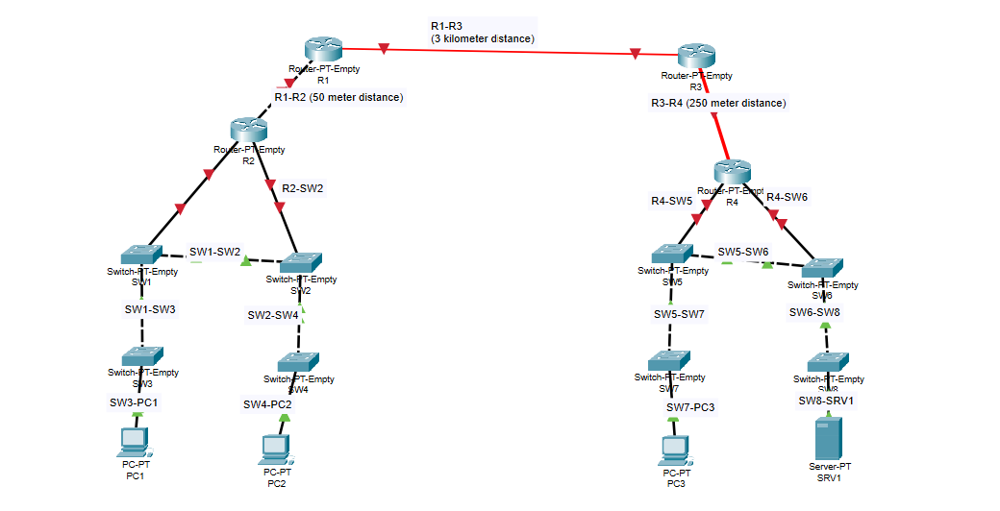

# Lab 002 - Connecting Devices

**Course:** [Jeremy's IT Lab - Day 02](https://youtu.be/K6Qt23sY68Y)  
**Software:** Cisco Packet Tracer  
**Topic:** Choosing network cables based on device type and distance

## About this lab

This second Packet Tracer lab was about connecting network devices using the right cables. The exercise asked me to think about whether the devices needed straight-through copper, crossover copper, or fiber, and to take the distance between devices into account.

For this lab, the instructions say to assume Auto-MDIX is disabled or unavailable. That means I couldn't just rely on devices automatically handling a straight-through or crossover connection.

## My topology

The network has four routers (R1–R4), eight switches (SW1–SW8), three PCs, and one server.

The switches form two groups beneath R2 and R4. The router links have three distance labels:

| Connection | Distance | Cable choice for the exercise |
| --- | --- | --- |
| R1–R2 | 50 meters | Copper crossover |
| R1–R3 | 3 kilometers | Single-mode fiber |
| R3–R4 | 250 meters | Multimode fiber |

The 3 km and 250 m examples helped put the difference between shorter and longer fiber connections into context. In real networks, the supported distance also depends on the Ethernet standard and transceivers being used.

## What I worked on

- Identifying which devices were being connected rather than choosing a cable at random.
- Using straight-through copper for connections such as PCs or servers to switches, and routers to switches.
- Using crossover copper for same-type Ethernet connections such as switch-to-switch and the 50-meter router-to-router link, since the exercise assumes no Auto-MDIX.
- Choosing fiber for the longer router links based on their labeled distances.

## What I noticed

What stood out to me was that choosing a cable isn't just about getting two devices physically connected. The type of devices and the distance between them both matter.

The R1–R2 link is only 50 meters, so copper makes sense for the lab. But the R1–R3 link is 3 kilometers, which is beyond the usual 100-meter limit of standard twisted-pair copper Ethernet links. The exercise also gave me a reason to think about single-mode versus multimode fiber instead of treating all fiber as the same thing.

## What I'm taking away

I have a better idea of when to use straight-through versus crossover cables in a network without Auto-MDIX. I also understand why distance is important when deciding between copper and fiber.

This exercise was about **cable selection and connecting devices**. It wasn't about enabling router interfaces, assigning IP addresses, or testing end-to-end connectivity, so I'm keeping those topics out of this lab's results.

## Lab files

- [Packet Tracer project](Lab-002.pkt)
- [Topology screenshot](network-topology.png)

## Credit

Based on [Jeremy's IT Lab - Day 02: Connecting Devices](https://youtu.be/K6Qt23sY68Y). These are my study notes from following the exercise.
