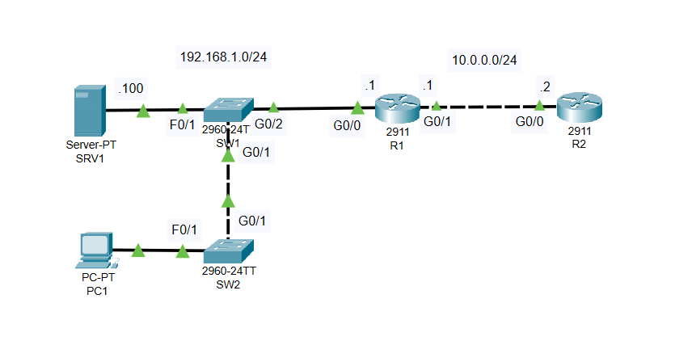
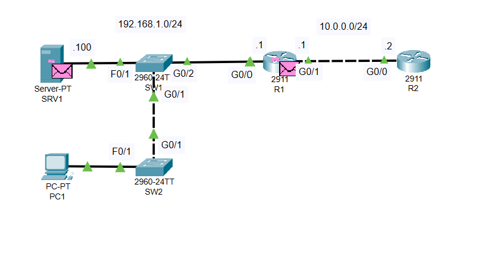
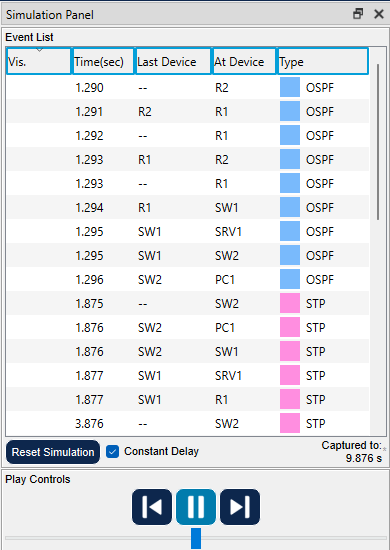

# Lab 003 - OSI Model

**Course:** [Jeremy's IT Lab - Day 03](https://youtu.be/7nmYoL0t2tU)  
**Software:** Cisco Packet Tracer  
**Topic:** Watching network traffic in Simulation Mode

## About this lab

For this lab, I used Packet Tracer's Simulation Mode to see some of the traffic moving through a small network. So far I've been working with the devices and cables themselves, but this exercise was more about what happens on the network once the devices are connected.

The network was already laid out, so I focused on observing the packets and the event list instead of building a new topology.

## My topology

The setup has a server (SRV1), a PC (PC1), two switches (SW1 and SW2), and two routers (R1 and R2).

SRV1 and PC1 are on the `192.168.1.0/24` side of the network. R1 connects that LAN to R2 over the `10.0.0.0/24` link.

- The server is labeled `.100` on the `192.168.1.0/24` network.
- R1 is labeled `.1` on both of its respective network segments.
- R2 is labeled `.2` on the `10.0.0.0/24` segment.

## What I worked on

- Opened the network in Packet Tracer and switched from Realtime Mode to Simulation Mode.
- Watched events appear as the simulation progressed.
- Looked at the packet indicators in the topology to see where traffic was being sent.
- Checked the event list to identify the protocols shown while the network was running.

## What I noticed

I could see **OSPF** and **STP** in the Simulation Panel. OSPF events appeared around the routers and also reached other devices in the simulation, while STP events appeared among the switches and connected devices.

It was useful seeing these as actual events instead of only reading their names in the CCNA material. The pink envelope symbols on the topology helped me connect the event list with the devices involved.

The event list tells me which protocol was involved and where the event appeared. It doesn't, by itself, show a complete breakdown of each OSI layer or prove that I analyzed the packet headers.

### Simulation screenshots

## What I'm taking away

Simulation Mode gives me a way to slow things down and follow what the network is doing. I can look at the protocol shown in the event list, click into individual events, and start connecting what I'm learning about the OSI model to traffic moving between real network devices in the simulator.

This was an introduction to watching network activity. I'm not claiming that I configured OSPF or STP, or that I tested end-to-end connectivity in this lab.

## Lab files

- [Packet Tracer project](Lab-003.pkt)
- [Network topology](network-topology.png)
- [Simulation packets](simulation-packets.png)
- [Simulation event list](simulation-event-list.png)

## Credit

Based on [Jeremy's IT Lab - Day 03: OSI Model](https://youtu.be/7nmYoL0t2tU). These are my own notes and screenshots from following the exercise.
