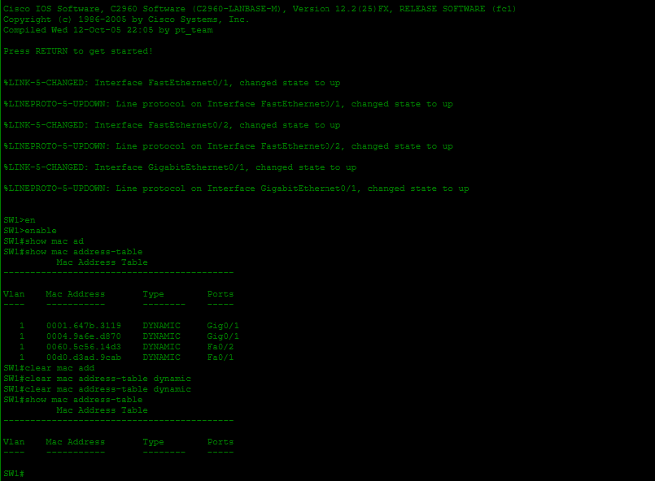
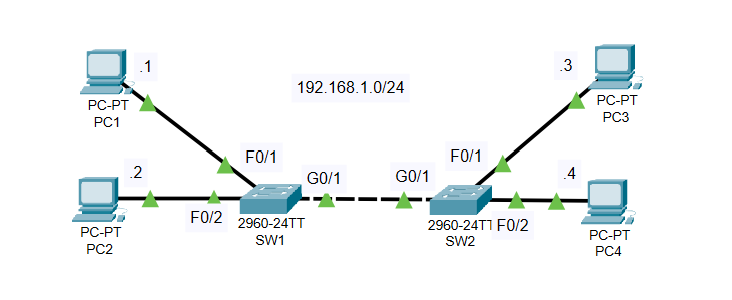

# Lab 005 - Ethernet LAN Switching (Days 05 and 06)

**Course:** [Jeremy's IT Lab - Ethernet LAN Switching](https://youtu.be/Ig0dSaOQDI8)  
**Software:** Cisco Packet Tracer  
**Topic:** MAC address tables, ARP, and Ethernet frame forwarding

## About this lab

This lab brings together the Ethernet switching lessons from Days 05 and 06 of Jeremy's IT Lab. Instead of just connecting devices, I worked with a small LAN to look at how switches learn MAC addresses and decide where to send frames.

The main idea was to see what happens when one PC tries to communicate with another, especially before the switches have learned where the devices are.

## My lab

The exercise uses two switches and four PCs. I used the Packet Tracer lab file and kept two screenshots from the exercise.

## What I worked on

- Following how an ARP request is broadcast when a PC needs to find the MAC address associated with an IP address.
- Looking at how a switch learns source MAC addresses from incoming Ethernet frames.
- Connecting the contents of a MAC address table to the switch ports that lead toward different devices.
- Understanding the difference between flooding a frame when the destination is unknown and forwarding a known unicast frame.
- Using the lab to connect the Ethernet theory from the lessons to what Packet Tracer shows.

## What I noticed

One of the more useful ideas from these lessons is that a switch doesn't start out knowing where every device is. It learns by reading the **source MAC address** of frames it receives and associating those addresses with incoming ports.

I also wanted to keep ARP and switching separate in my notes. ARP helps an IPv4 host find a destination's MAC address on the local network; the switch uses its MAC address table to decide where to forward an Ethernet frame. Those are related steps, but they aren't the same job.

A broadcast ARP request is flooded within the relevant VLAN, while a known unicast frame can be sent out the learned destination port. An unknown unicast frame may also be flooded until the destination is learned.

## What I'm taking away

I'm starting to see why understanding MAC address tables is useful for troubleshooting a LAN. When traffic isn't reaching the right device, it's important to know what a switch has learned, how ARP works, and which port a frame should travel through.

The main focus of this lab was **Ethernet switching behavior**, not configuring routing or VLANs. I've kept the write-up focused on the switching concepts covered in the exercise rather than claiming tests or commands that I haven't separately documented.

## Lab files

- [Packet Tracer project](Lab-005.pkt)
- [Lab screenshot 1](lab-screenshot-01.png)
- [Lab screenshot 2](lab-screenshot-02.png)

## Credit

Based on Jeremy's IT Lab, Days 05 and 06, including the [Ethernet LAN Switching Packet Tracer exercise](https://youtu.be/Ig0dSaOQDI8). These are my study notes from following the lab.
