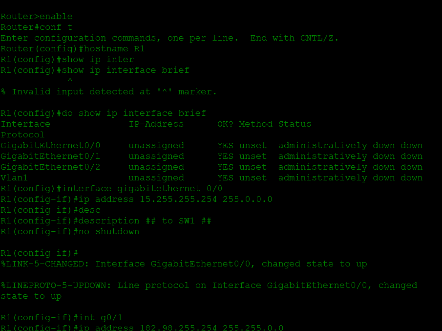
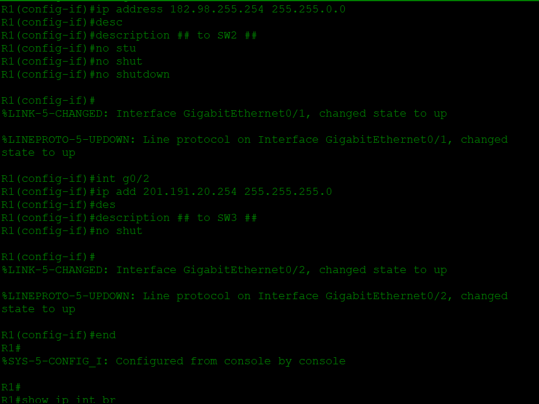
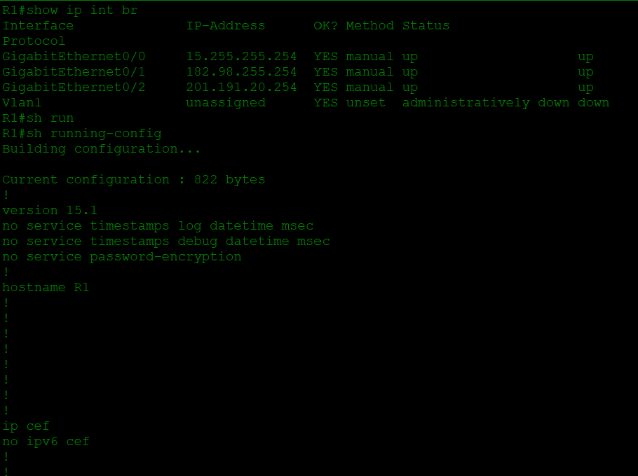
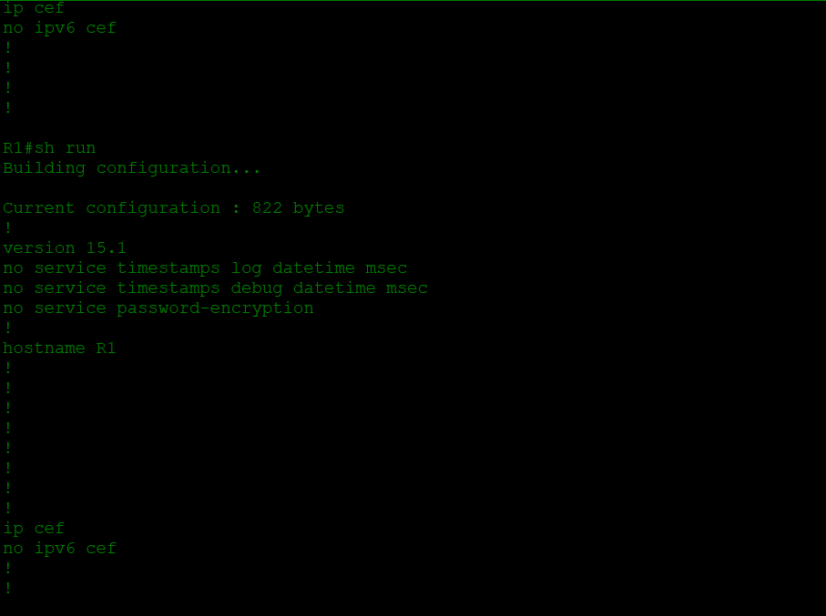
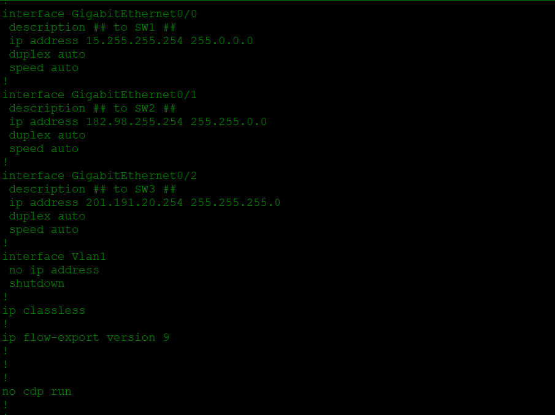
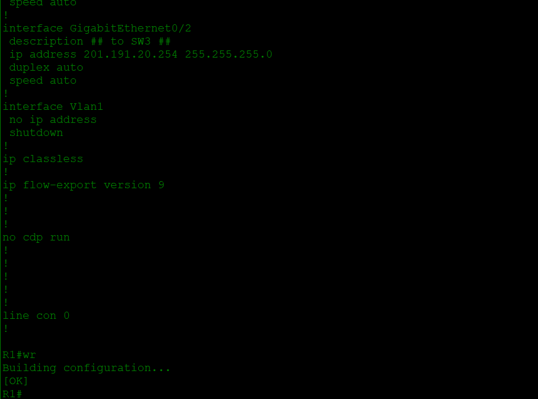

# Lab 006 - IPv4 Addressing

**Course:** [Jeremy's IT Lab - Day 08](https://youtu.be/e1jbvyMeS5I)  
**Software:** Cisco Packet Tracer  
**Topic:** Configuring IPv4 addresses on router interfaces

## About this lab

For this lab, I practiced configuring IP addresses directly on a router using the Cisco IOS CLI. After learning the basics of IPv4 addressing, I wanted to get more comfortable seeing how an address and subnet mask are actually applied to an interface.

I worked on router R1, which has three GigabitEthernet interfaces connecting to different switches. I also used `show ip interface brief` and `show running-config` to check what I had configured.

## What I worked on

I started by entering privileged EXEC mode and global configuration mode, then changing the router hostname to `R1`.

At first, I tried `show ip interface brief` from global configuration mode and got an invalid input error. I corrected that by using `do show ip interface brief`. The output showed the router interfaces as unassigned and administratively down.

Then I configured each interface with an address, subnet mask, and a description showing which switch it connected to.

| Router interface | IPv4 address | Subnet mask | Description |
| --- | --- | --- | --- |
| GigabitEthernet0/0 | `15.255.255.254` | `255.0.0.0` | to SW1 |
| GigabitEthernet0/1 | `182.98.255.254` | `255.255.0.0` | to SW2 |
| GigabitEthernet0/2 | `201.191.20.254` | `255.255.255.0` | to SW3 |

I used `no shutdown` on all three interfaces to bring them out of the administratively down state.

### Commands I practiced

```text
enable
configure terminal
hostname R1
do show ip interface brief

interface gigabitEthernet 0/0
 ip address 15.255.255.254 255.0.0.0
 description ## to SW1 ##
 no shutdown

interface gigabitEthernet 0/1
 ip address 182.98.255.254 255.255.0.0
 description ## to SW2 ##
 no shutdown

interface gigabitEthernet 0/2
 ip address 201.191.20.254 255.255.255.0
 description ## to SW3 ##
 no shutdown

end
show ip interface brief
show running-config
write
```

These are the main commands from my CLI screenshots, written out in full rather than keeping every abbreviation and repeated attempt.

## Checking my configuration

After configuring the interfaces, I ran `show ip interface brief` again. This time, all three GigabitEthernet interfaces showed their assigned IP addresses with **Status up** and **Protocol up**.

I also reviewed `show running-config` and saw the descriptions, IP addresses, and masks under the correct interfaces. At the end I used `wr` (short for `write memory`) and got an `[OK]` confirmation that the configuration was saved.

### CLI screenshots

These screenshots show the configuration process in order.

### Initial interface check and first configuration



### Configuring the remaining router interfaces



### Verifying the configured IP addresses and interface states



### Reviewing the running configuration



### Checking interface descriptions and subnet masks



### Saving the configuration



## What I noticed

The difference between `R1(config)#` and `R1#` came up again in this lab. A show command that I tried from configuration mode didn't work until I added `do`.

Seeing `administratively down` before the changes and `up/up` afterward helped me understand why `no shutdown` matters. The interface needs both an IP configuration and an active link before it can be used to communicate.

I also liked seeing the subnet masks written alongside each address, instead of just working with CIDR notation on paper.

## What I'm taking away

I'm starting to feel more familiar with moving around the Cisco CLI to configure interfaces and then checking my work. Assigning an IPv4 address is only part of the job; I also need to verify the interface status and make sure the configuration was saved.

These screenshots show R1 interface configuration and verification. They don't independently show PC addressing, successful ping tests, or routing between networks, so I'm not claiming those results here.

## Lab files

- [Packet Tracer project](Lab-006.pkt)
- [CLI screenshots](#cli-screenshots) - Six screenshots showing the router configuration and verification

## Credit

Based on [Jeremy's IT Lab - Day 08 IPv4 Addresses](https://youtu.be/e1jbvyMeS5I). These are my study notes from following the exercise.
