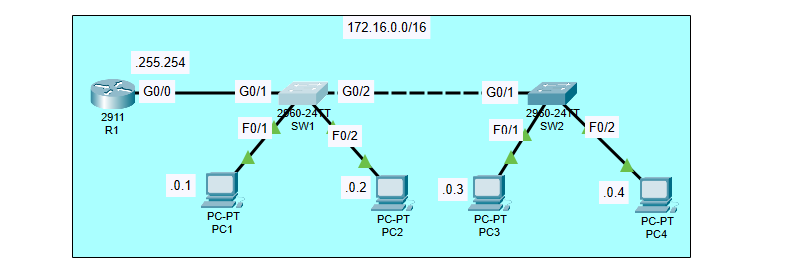
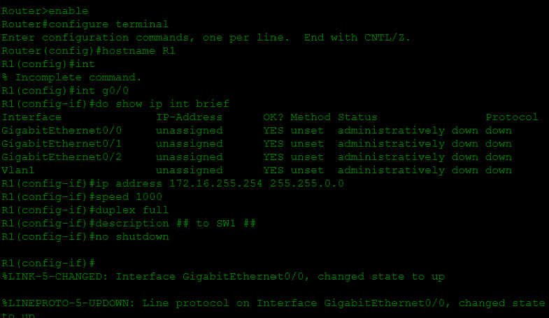
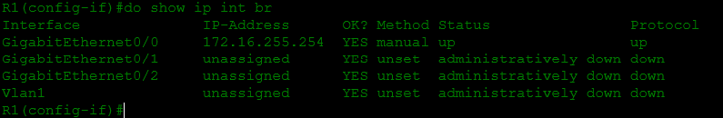
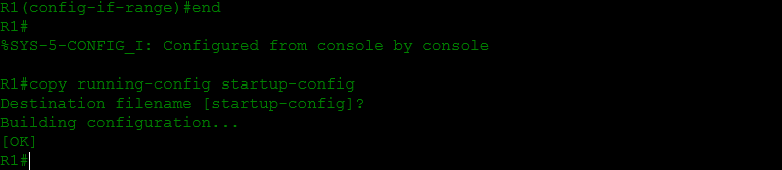
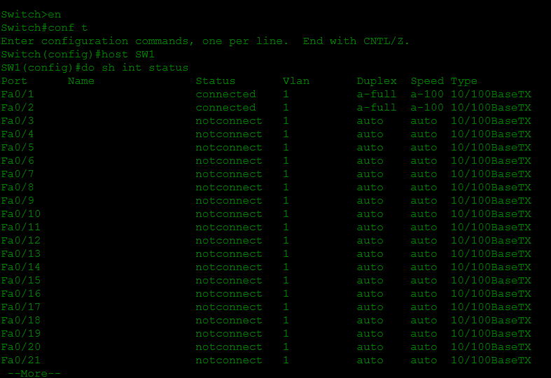
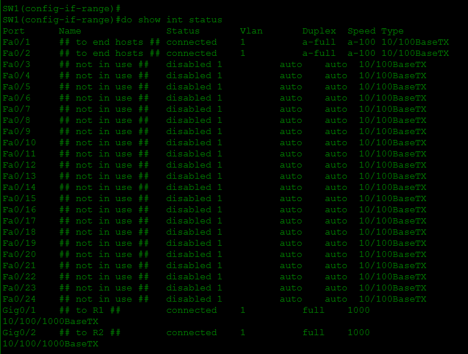
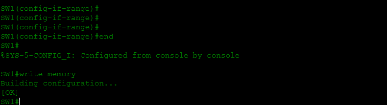
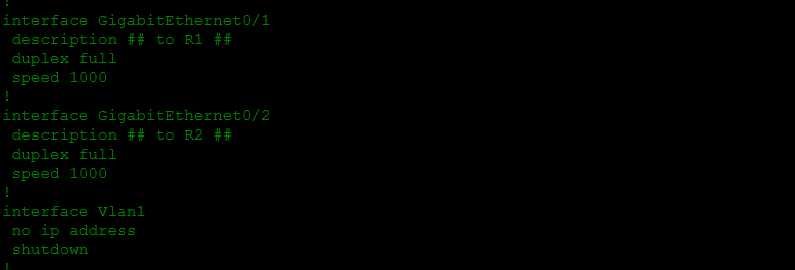
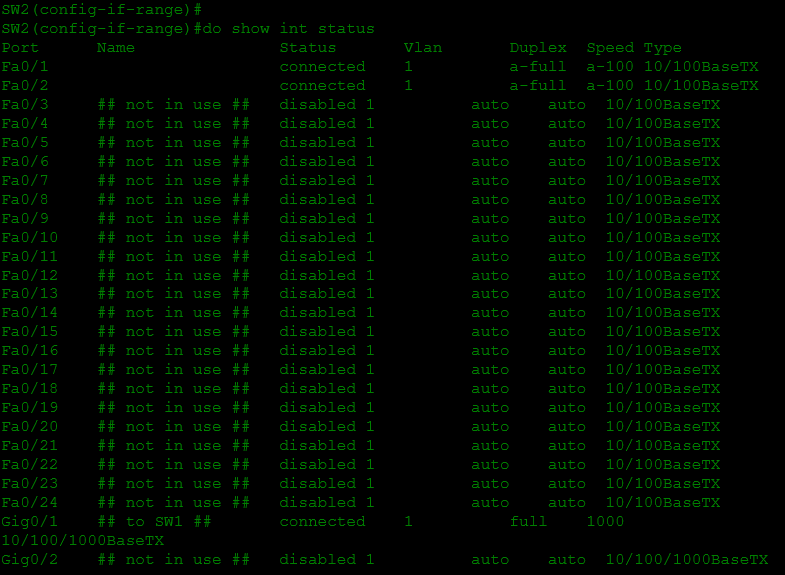

# Lab 007 - Configuring Interfaces

**Course:** [Jeremy's IT Lab - Day 09](https://www.youtube.com/watch?v=rzDb5DoBKRk)  
**Software:** Cisco Packet Tracer  
**Topic:** Router and switch interfaces, speed/duplex, interface descriptions, and disabling unused ports

## About this lab

For this lab I worked on configuring the interfaces of a router and two switches. It felt like a step forward from just assigning IP addresses, because I also had to check which ports were in use, set the appropriate interface settings, and shut down the ones that weren't needed.

I used the CLI on R1, SW1, and SW2. I kept screenshots of the configurations and the commands I used to check my work.

## My topology



Everything in this lab is on the `172.16.0.0/16` network. R1 connects to SW1, SW1 connects to SW2, and each switch connects to two PCs.

| Device | IPv4 address shown in the lab |
| --- | --- |
| R1 G0/0 | `172.16.255.254/16` |
| PC1 | `172.16.0.1/16` |
| PC2 | `172.16.0.2/16` |
| PC3 | `172.16.0.3/16` |
| PC4 | `172.16.0.4/16` |

## What I worked on

### Configuring R1

I changed the router's hostname to `R1` and checked the interfaces with `show ip interface brief`. At first, G0/0 was unassigned and administratively down. I configured its address, set its speed to 1000 Mbps and duplex to full, added a description for the connection to SW1, and used `no shutdown`.

Here are the main commands I used:

```text
enable
configure terminal
hostname R1
interface gigabitEthernet 0/0
 ip address 172.16.255.254 255.255.0.0
 speed 1000
 duplex full
 description ## to SW1 ##
 no shutdown
```

I also left G0/1 and G0/2 shut down and marked them as not in use.



Afterward, `show ip interface brief` showed G0/0 as **up/up** with the configured IP address. I checked the running configuration and saved my changes.





### Checking PC1's address

I checked PC1's interface configuration in Packet Tracer. It shows a static IPv4 address of `172.16.0.1` with a subnet mask of `255.255.0.0`.



### Configuring SW1

On SW1 I gave the switch its hostname, configured the GigabitEthernet ports used for the connections toward R1 and SW2, and added descriptions.

I also used an interface range to label and shut down the unused FastEthernet ports. I made a couple of syntax mistakes with interface and interface-range commands before correcting them.



The final `show interfaces status` output showed Fa0/1 and Fa0/2 connected to the PCs, G0/1 and G0/2 connected at **1000 Mbps/full duplex**, and the unused FastEthernet ports disabled.



I saved SW1's configuration with `write memory`.



### Checking SW2

On SW2 I configured its link toward SW1 and disabled unused ports. The status output showed the two PC-facing FastEthernet ports connected, G0/1 connected at **1000 Mbps/full duplex**, and the unused ports disabled.



## What I noticed

I ran into a few small IOS command errors while moving between interface modes and using `interface range`. Correcting those helped me get more familiar with the exact syntax and with checking which mode I was in.

The biggest difference I noticed was seeing how much information `show interfaces status` gives me on a switch. I could see which ports were connected, which were disabled, and what speed and duplex were being used. That made it easier to tell whether the intended ports were set up correctly.

I also liked using interface descriptions. They make the configuration easier to read later, especially when a device has a lot of ports.

## What I'm taking away

This lab was good practice for configuring interfaces carefully instead of assuming all ports should be left enabled. I'm getting more comfortable using the CLI, documenting what each interface connects to, checking its state, and saving the changes.

The screenshots show the router and switch configurations and their interface states. They **don't show ping tests**, so I'm not treating the lab as proof of end-to-end connectivity.

## Lab files

- [Packet Tracer project](Lab-007.pkt)
- [Network topology](network-topology.png)
- Eight CLI and PC configuration screenshots embedded above

## Credit

Based on [Jeremy's IT Lab - Day 09: Configuring Interfaces](https://www.youtube.com/watch?v=rzDb5DoBKRk). These are my personal notes and screenshots from completing the exercise.
